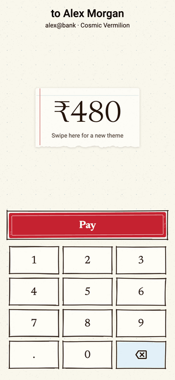
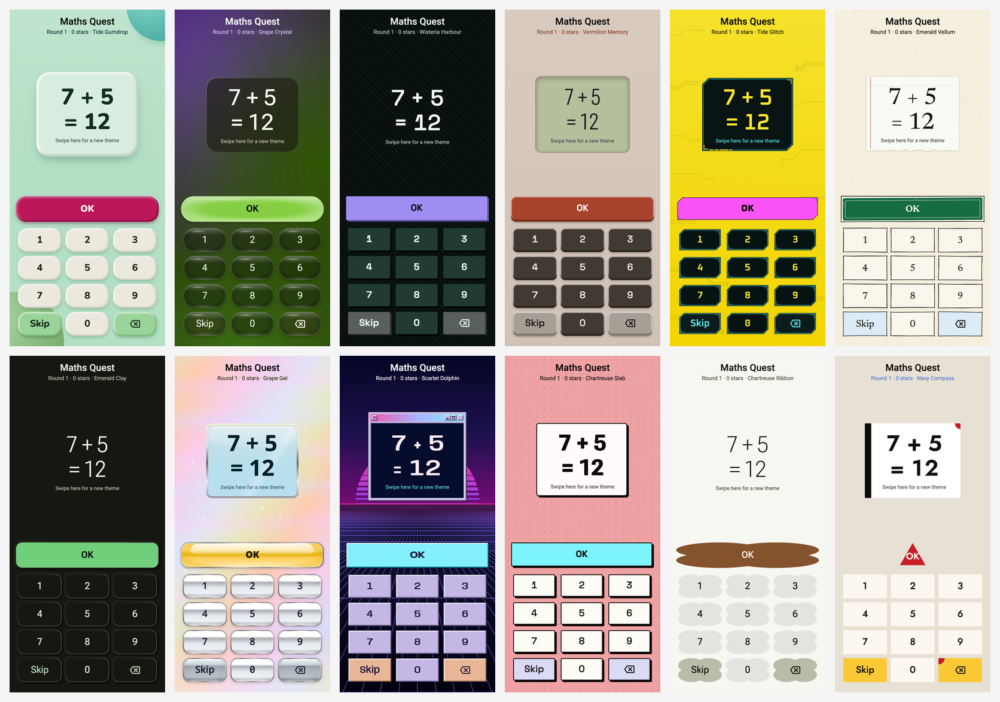

# calsee_themes

Endless generated themes for Flutter. Users swipe and get a new look:
new colours, shapes, fonts, key press motion and backdrop. Every theme
belongs to one of twelve visual families.

The themes come from the [Calsee](https://calsee.tech) calculator. This
package lets any app use them on any screen: your widgets and logic stay
as they are, and the package handles how they look.

Picture a kids' maths game where a swipe gives the number pad a new
look. Each one passes the contrast checks, so every look stays easy to
read.

<p align="center"></p>



## Features

- **An endless feed of themes.** It's seeded and bit-exact: a given seed
  shows the same themes on every device. Swipe forward for a new theme,
  or back for the exact previous one.
- **Twelve families:** Claymorphism, Liquid Glass, NeoPOP, Retro,
  Cyberpunk, Paper & Ink, Neumorphism, Y2K Aero, Vaporwave,
  Neo-brutalism, Material 3 Expressive and Bauhaus.
- **Drop-in widgets.** Themed keys and buttons with each family's spring
  press (Clay squishes, NeoPOP extrudes, Glass inflates), form controls
  (checkboxes, radios, switches, segmented buttons, sliders, dropdowns,
  expandable sections and text fields), plus backdrops with ambient
  artwork, display panels and display text.
- **Steerable.** Describe a look (colours, light or dark, how colourful)
  and the feed generates endless variations on it. Pair it with an
  on-device model to turn "playful greenery" into themes.
- **Readable by construction.** Every generated theme passes contrast
  guardrails, including colour-blindness checks. There's an accessible
  mode with stricter contrast, and the widgets follow High Contrast,
  Reduce Motion and Bold Text.
- **No setup.** The fonts are bundled (all SIL OFL), it works fully
  offline, and it supports Flutter 3.35 and newer.

## Install

```yaml
dependencies:
  calsee_themes: ^1.1.0
```

```dart
import 'package:calsee_themes/calsee_themes.dart';
```

## Quick start

Wrap a screen in a `CalseeScope`, then build it from the themed widgets:

```dart
CalseeScope(
  child: CalseeBackdrop(
    child: Column(
      children: [
        // Swipe the sum for a new theme.
        Expanded(
          child: CalseeSwipeArea(
            child: Center(
              child: CalseeDisplayPanel(
                child: CalseeReadout('7 + 5 = ?', size: 64),
              ),
            ),
          ),
        ),
        SizedBox(
          height: 64,
          child: CalseeKey.text('OK', role: KeyRole.equals, onPressed: check),
        ),
        // ...a grid of CalseeKey.text('1', role: KeyRole.digit, ...)
      ],
    ),
  ),
)
```

Only what's below the scope is themed, so you can add themes to a single
screen of an existing app. Your handlers (`check`, `onKey`) stay exactly as
they are.

## Theming an existing screen

Swap each visual piece for its themed version and keep your callbacks.

| Your widget | Themed version |
|---|---|
| Screen background | `CalseeBackdrop` |
| Number keys | `CalseeKey.text(d, role: KeyRole.digit)` |
| `.` key | `CalseeKey.text('.', role: KeyRole.decimal)` |
| Backspace | `CalseeKey.icon(..., role: KeyRole.backspace)` |
| Primary action (OK, Submit) | `CalseeKey.text(..., role: KeyRole.equals)` (the theme's accent) |
| Secondary actions | `KeyRole.operator` or `KeyRole.function` |
| Amount, score or timer | `CalseeDisplayPanel` + `CalseeReadout` |
| Cards and tiles that aren't buttons | `CalseeSurface` |
| Checkbox, radio button, switch | `CalseeCheckbox`, `CalseeRadio`, `CalseeSwitch` |
| Segmented buttons, slider | `CalseeSegmented`, `CalseeSlider` |
| Dropdown, expandable section | `CalseeDropdown`, `CalseeExpandable` |
| Text input | `CalseeTextField` |
| Other text | `CalseeTextColors.of(context)` (`primary`, `secondary`) |

For any other colour, font or shape, read the theme directly with
`CalcTheme.of(context)`.

The [example app](example/lib/main.dart) is a complete kids' maths game
built this way.

**[Drawing themed UI](doc/guide.md)** covers every element with a snippet
and its full source. The **[live gallery](https://mishrabhilash.github.io/calsee_themes/)**
runs each example in your browser, in every family but Bauhaus.

## Keeping the user's theme

The feed is a small JSON object. Save it whenever it changes and restore it
at launch:

```dart
CalseeScope(
  savedState: prefs.getString('theme') == null
      ? null
      : jsonDecode(prefs.getString('theme')!),
  onChanged: (state) => prefs.setString('theme', jsonEncode(state)),
  child: ...,
)
```

To change themes from your own UI (buttons, a menu, a timer), use the
controller:

```dart
final themes = CalseeScope.of(context);
themes.next();
themes.previous();
themes.spec.name; // e.g. "Tide Gumdrop"
```

## Choosing families

```dart
CalseeScope(
  families: const [
    ThemeFamily.claymorphism,
    ThemeFamily.liquidGlass,
    ThemeFamily.retro,
  ],
  child: ...,
)
```

Two families reshape keys by role: **Material 3 Expressive** (blob and
pentagon shapes) and **Bauhaus** (circles and triangles). On screens where
one button must always look like a plain button, such as a checkout or
sign-in button, leave those two out.

## Steering themes from words

A `ThemeIntent` describes the look you want. Every field is optional:

```dart
final themes = CalseeThemeController(
  intent: ThemeIntent(
    brightness: ThemeBrightness.light,
    colors: const [IntentColor.green, IntentColor.lime],
    chroma: IntentChroma.vivid,
    harmony: HarmonyScheme.analogous,
    name: 'Playful Greenery',
  ),
);
// Later: themes.intent = …; or null for the normal feed.
```

The feed then shows endless variations on the intent, starting with the
one closest to its centre. Every theme still passes the contrast
guardrails. Material 3 Expressive, NeoPOP and Claymorphism honour
steering (`steerableFamilies`). Other families take only the name.
`intent.reportFor(family)` lists the hints a family can't follow, for
example "light" for NeoPOP, which is dark-only.

To turn a user's words into an intent, give a model the format and parse
what it returns:

```dart
final prompt = ThemeIntent.promptFragment(); // or ThemeIntent.jsonSchema()
final result = ThemeIntent.parse(modelOutput); // never throws
themes.intent = result.intent; // result.dropped lists what was ignored
```

`ThemeIntent.vocabulary` has every field and value, each with a one-line
description, so you can build your own prompt or schema. The package
never sees the user's words, and nothing leaves the device unless your
app sends it.

## Accessibility

- Every theme passes contrast guardrails for text, keys and the display.
  The checks include colour-blindness simulation.
- `CalseeThemeController(accessible: true)` shows only themes that pass
  stricter contrast. You can also set `controller.accessible` at runtime.
- When the platform's **High Contrast** setting is on, the scope resolves
  themes in high contrast.
- **Reduce Motion** turns off spring presses and ambient animation, and
  **Bold Text** makes key labels heavier.

## More

- `themeOfTheDay(DateTime.now())` gives every user the same theme on a
  given day. Show it with `controller.jumpTo(...)`.
- Share codes (`FeedEntry.shareCode`, `decodeShareCode`,
  `FeedEntry.fromSharePayload`) let users send each other a theme.
  Steered themes get a longer code that carries the intent.
- `CalcThemeData` (from `CalcTheme.of`) exposes the colours, fonts,
  springs and renderers behind every widget here.

## App size

Adding the package to a release build costs about **3.4 MB on Android**
and **4.5 MB on iOS**:

| Release build | Without | With | Added | Dart code | Fonts |
|---|---|---|---|---|---|
| Android APK (arm64) | 14.3 MB | 17.7 MB | **+3.4 MB** | +1.4 MB | +1.7 MB |
| iOS `Runner.app` | 13.3 MB | 17.8 MB | **+4.5 MB** | +1.5 MB | +2.9 MB |

The figures compare two minimal apps built with Flutter 3.47.6: a
screen with a readout and four keys, made once from plain widgets
and once from `CalseeScope` with all twelve families. The APK figures
are compressed sizes. The iOS figures are the unpacked app bundle, so the
App Store download is smaller. Most of the remaining 0.3 MB on Android
is the `dynamic_color` plugin's Java code and resources.

## Fonts and licence

The package is MIT-licensed. Its fonts are bundled under the SIL Open Font
License 1.1: Roboto Flex, Space Grotesk, Nunito, Open Sans, Newsreader,
Oxanium, Anybody, Jost, Patrick Hand, Noto Sans Devanagari and Calsee
Symbols. Sources and checksums are in [fonts/README.md](fonts/README.md).
Together they take 2.9 MB uncompressed (1.7 MB compressed in an APK).
